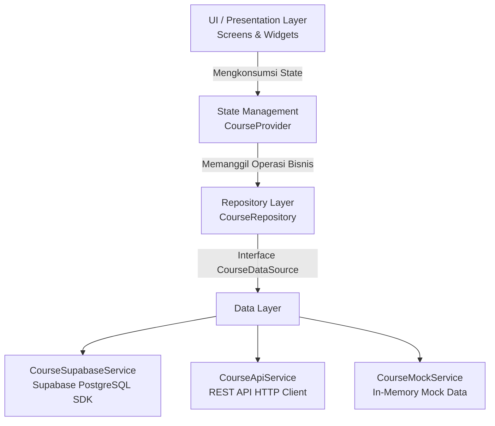

# Course Data Manager - Flutter Mobile App

Proyek praktikum **Pemrograman Mobile | Pertemuan 7: RESTful API, Backend Services & Database Integration**.

---

## Identitas Pengembang
- **Nama:** Gede Krisna Adi Pramana
- **NIM:** 2415051036
- **Program Studi:** Pendidikan Teknik Informatika
- **Repository GitHub:** [Responsive-Layout-Navigation-User-Interaction](https://github.com/gedek0815-maker/Responsive-Layout-Navigation-User-Interaction)

---

## Deskripsi Aplikasi
**Course Data Manager** adalah aplikasi mobile berbasis Flutter yang dirancang untuk mengelola data mata kuliah secara menyeluruh dengan fitur CRUD (*Create, Read, Update, Delete*). Aplikasi ini terintegrasi langsung dengan database cloud PostgreSQL melalui layanan BaaS (*Backend as a Service*) **Supabase**, serta mendukung pergantian data source secara modular (Mock Data, REST API HTTP, dan Supabase).

Aplikasi dilengkapi antarmuka adaptif/responsif yang menyesuaikan tata letak navigasi sesuai orientasi atau lebar layar perangkat (Navigation Rail untuk layar lebar dan Navigation Bar untuk layar standar/ponsel), fitur penandaan mata kuliah favorit, dan sistem penanganan error yang tangguh.

---

## Arsitektur Aplikasi
Aplikasi dibangun dengan memisahkan tanggung jawab kode (*Separation of Concerns*) menggunakan pola arsitektur berlapis:



1. **Presentation Layer (UI):**
   - `ResponsiveShell`: Shell navigasi adaptif (`NavigationBar` pada mode portrait/ponsel dan `NavigationRail` pada mode landscape/tablet).
   - `CourseListPage`: Menampilkan daftar mata kuliah dari database dengan banner identitas mahasiswa dan tombol tambah.
   - `CourseDetailPage`: Menampilkan rincian informasi mata kuliah beserta tombol aksi edit, hapus, dan toggle favorit.
   - `CourseFormPage`: Formulir validasi untuk menambah (*INSERT*) dan memperbarui (*UPDATE*) mata kuliah.
   - `FavoritesPage`: Halaman khusus daftar mata kuliah yang ditandai favorit.

2. **State Management (`CourseProvider`):**
   - Menggunakan `ChangeNotifier` dari paket `provider`.
   - Mengisolasi logika bisnis dari dependensi HTTP maupun database eksternal.
   - Mengelola state loading (`isLoading`, `isSaving`), error (`error`), data courses, dan set favorit.

3. **Repository Pattern (`CourseRepository`):**
   - Berperan sebagai *Single Source of Truth*.
   - Mengabstraksi sumber data melalui kontrak antarmuka `CourseDataSource`.

4. **Data Source Layer:**
   - `CourseSupabaseService`: Mengimplementasikan integrasi langsung dengan Supabase Client via RPC dan query builder (`select`, `insert`, `update`, `delete`).

---

## Backend & Keamanan (Security Hardening)
Aplikasi terhubung ke backend **Supabase** dengan spesifikasi:
- **Database Engine:** PostgreSQL
- **Tabel:** `courses`
- **Skema Kolom:**
  - `id`: `BIGINT PRIMARY KEY GENERATED ALWAYS AS IDENTITY`
  - `code`: `TEXT UNIQUE NOT NULL`
  - `title`: `TEXT NOT NULL`
  - `credits`: `INTEGER NOT NULL CHECK (credits > 0)`
  - `status`: `TEXT NOT NULL CHECK (status IN ('planned', 'active', 'done'))`
  - `created_at`: `TIMESTAMPTZ DEFAULT now()`

### Security Checklist & Hardening
- **Row Level Security (RLS):** Diaktifkan penuh pada tabel `courses` dengan policy izin untuk anonim (`anon role`) untuk operasi SELECT, INSERT, UPDATE, dan DELETE.
- **Client Security:** Hanya menggunakan *publishable/anon key* pada aplikasi client. Kunci sensitif (*service_role key*) tidak pernah disimpan di source code maupun repository.
- **Integritas Data:** Validasi backend menggunakan *Check Constraint* (`status IN ('planned', 'active', 'done')`) memastikan data konsisten bahkan jika request melewati batas validasi antarmuka.
- **Error & Exception Handling:** Seluruh pemanggilan asinkronus dibungkus blok `try-catch` dengan menampilkan umpan balik yang aman dan informatif kepada pengguna melalui `SnackBar` dan banner error tanpa membocorkan kredensial.

---

## Cara Menjalankan Aplikasi

### Prasyarat
- Flutter SDK (versi 3.10.0 atau lebih baru)
- Dart SDK
- Android Studio / VS Code dengan ekstensi Flutter & Dart
- Emulator Android atau perangkat fisik

### Langkah Instalasi
1. **Clone repository:**
   ```bash
   git clone https://github.com/gedek0815-maker/Responsive-Layout-Navigation-User-Interaction.git
   cd flutter_ui_fundamentals
   ```

2. **Unduh seluruh dependensi:**
   ```bash
   flutter pub get
   ```

3. **Jalankan aplikasi:**
   ```bash
   flutter run
   ```
